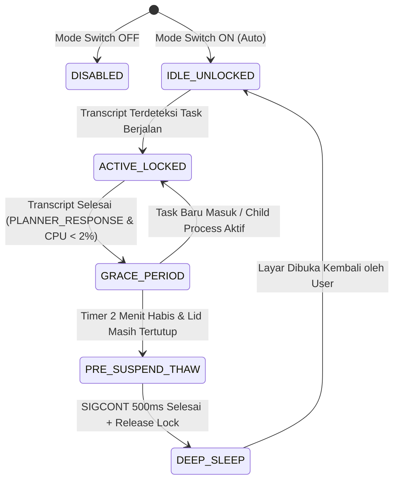

# Product Requirements Document (PRD)
## Antigravity KeepAwake (Ubuntu 22.04 LTS / GNOME 42)

**Version:** 1.0.0  
**Status:** Approved Architecture  
**Author:** AI Engineering & Systems Pair Programming  
**Last Updated:** 2026-11-01  

---

## 1. Problem Statement & User Persona

### 1.1 Problem Statement
Pengembang perangkat lunak yang menggunakan agen AI otonom seperti Antigravity sering kali menjalankan tugas coding kompleks (kompilasi kode, suite pengujian, pemfaktoran ulang multi-file, web research) yang membutuhkan waktu 5–30 menit. Saat pengembang menutup layar laptop (lid-close) untuk berpindah tempat atau menyimpan laptop di meja/tas, perilaku bawaan Ubuntu/systemd adalah memicu status **Suspend (Sleep)**. Hal ini memutus koneksi jaringan dan mematikan eksekusi agen Antigravity di tengah jalan.

Solusi umum seperti ekstensi *Caffeine* mencegah sleep secara statis dan tanpa batas waktu, yang berisiko:
1. Menghabiskan daya baterai secara sia-sia saat tugas telah selesai.
2. Menyebabkan *thermal runaway* (laptop terus membakar daya di dalam tas tanpa ventilasi).
3. Mengabaikan beban CPU aplikasi lain (seperti browser Chrome dengan puluhan tab) yang terus mengonsumsi baterai dan daya komputasi saat layar tertutup.

### 1.2 User Persona
- **Nama:** Software Engineer / AI Pair Programmer
- **OS:** Ubuntu 22.04.5 LTS (GNOME Shell 42, Wayland/X11, systemd 249)
- **Kebutuhan Utama:** Menutup layar laptop dengan aman saat Antigravity sedang bekerja, menghemat baterai dengan membekukan aplikasi berat yang tidak relevan, dan membiarkan laptop otomatis tidur pulas begitu Antigravity menyelesaikan pekerjaannya.

---

## 2. System Architecture & Tech Stack

Sistem Antigravity KeepAwake menggunakan arsitektur modular terpisah dua lapis (**Dual-Tier Decoupled Architecture**) untuk menjamin stabilitas GNOME Shell dan mematuhi batas hak akses Linux unprivileged.

```text
┌────────────────────────────────────────────────────────────────────────┐
│                        GNOME Shell 42 Panel                            │
│  [Activities]       [  Clock / Date  ]      [⚡ 💤 🛑 KeepAwake Toggle]  │
└────────────────────────────────────▲───────────────────────────────────┘
                                     │ Session D-Bus
                                     │ (org.antigravity.KeepAwake)
┌────────────────────────────────────▼───────────────────────────────────┐
│               Rust Background Daemon (systemd --user)                  │
│  ┌────────────────────────┐  ┌──────────────────────────────────────┐  │
│  │ Activity Sentinel      │  │ Sleep Inhibitor Engine               │  │
│  │ (inotify transcript)   │  │ (org.freedesktop.login1.Manager)     │  │
│  └───────────┬────────────┘  └──────────────────┬───────────────────┘  │
│              │                                  │                      │
│  ┌───────────▼────────────┐  ┌──────────────────▼───────────────────┐  │
│  │ Smart Resource Freezer │  │ Thermal & Battery Floor Guard        │  │
│  │ (SIGSTOP / SIGCONT)    │  │ (UPower / sysfs thermal_zone)        │  │
│  └────────────────────────┘  └──────────────────────────────────────┘  │
└────────────────────────────────────────────────────────────────────────┘
```

### 2.1 Tech Stack
1. **Frontend / UI Layer:**
   - **GNOME Shell Extension (GJS / JavaScript ES6):** Bertengger di top bar tepat di samping jam/center panel.
   - **GNOME GSettings (`glib-2.0` schema):** Menyimpan preferensi pengguna dan tersinkronisasi secara reaktif.
2. **Backend / Core Engine Layer:**
   - **Rust (edition 2021) Background Daemon:** Dikelola sebagai unit `systemd --user`.
   - **Libraries / Crates:** `zbus` (D-Bus async IPC murni), `notify` (Linux inotify watcher), `sysinfo` & `nix` (process tree inspection & POSIX signal control), `tokio` (asynchronous runtime).
   - **Memory Target:** **< 8 MB RSS** (ultra-ringan, single compiled native ELF binary).
3. **Privilege Boundary:**
   - **100% Unprivileged:** Seluruh komponen berjalan di ruang user (`UID 1000`), tidak memerlukan `sudo` atau hak akses root.

---

## 3. Power Management Protocol (systemd-inhibit D-Bus Spec)

Pencegahan sleep saat layar ditutup dilakukan melalui antarmuka resmi D-Bus `systemd-logind`.

### 3.1 Akuisisi Kunci Penghambat (Inhibitor Lock)
- **Bus:** System Bus (`org.freedesktop.login1`)
- **Object Path:** `/org/freedesktop/login1`
- **Interface:** `org.freedesktop.login1.Manager`
- **Method:** `Inhibit(what, who, why, mode) -> fd`
- **Parameter Nilai:**
  - `what`: `"handle-lid-switch"` (khusus menahan aksi penutupan engsel layar)
  - `who`: `"Antigravity KeepAwake"`
  - `why`: `"Antigravity agent task in progress"`
  - `mode`: `"block"`
- **Lifecycle File Descriptor:** Daemon menahan File Descriptor (FD) yang dikembalikan oleh D-Bus. Selama FD ini terbuka, `systemd-logind` dilarang memicu suspend saat engsel tertutup. Menutup FD (`os.close(fd)`) secara otomatis melepaskan proteksi.

### 3.2 Deteksi Sensor Engsel Layar (Lid State Monitoring)
- **Property:** `org.freedesktop.login1.Manager.LidClosed` (Boolean)
- **Signal:** `org.freedesktop.DBus.Properties.PropertiesChanged` pada path `/org/freedesktop/login1`
- **Karakteristik:** Zero-polling; daemon menerima notifikasi asinkron instan saat engsel ditutup (`true`) atau dibuka (`false`).

### 3.3 Eksekusi Tidur Pulas (Explicit Sleep Trigger)
Saat tugas selesai dan grace period kedaluwarsa:
- **Method Call:** `org.freedesktop.login1.Manager.Suspend(true)` atau CLI `systemctl suspend`.

---

## 4. Process Lifecycle & Detection Algorithm

### 4.1 State Machine Lifecycle


### 4.2 Algoritma Sentinel (inotify Transcript Watcher)
1. **Target Direktori:** `~/.gemini/antigravity-ide/brain/*/logs/transcript.jsonl`
2. **Inotify Mask:** `IN_MODIFY | IN_CLOSE_WRITE`
3. **Kriteria State `ACTIVE` (Coding Task Sedang Berjalan):**
   - Entry terakhir pada `transcript.jsonl` bertipe `RUN_COMMAND`, `BROWSER_SUBAGENT`, `GENERATE_IMAGE`, atau `TOOL_CALL` dengan status `IN_PROGRESS`.
   - Atau child process di bawah workspace Antigravity (seperti `git`, `python`, `npm`, `pytest`, `cargo`, `go`) terdeteksi di `/proc`.
4. **Kriteria State `IDLE` (Tugas Selesai / Menunggu Prompt User):**
   - Entry terakhir bertipe `PLANNER_RESPONSE` dengan status `DONE` dan tidak memiliki pending tool calls.
   - Tidak ada sub-proses aktif di bawah tree Antigravity (beban CPU Antigravity < 2%).
5. **Masa Tenggang (Grace Period):**
   - Timer 2 menit diaktifkan saat transisi ke `IDLE`.
   - Jika selama 120 detik tidak ada aktivitas penulisan berkas baru atau child process baru, status ditetapkan: **Tuntas**.

---

## 5. Smart Resource Freeze Specification (SIGSTOP / SIGCONT)

Untuk menghemat baterai dan menjaga suhu tetap dingin saat laptop tertutup, sistem menerapkan **Taksonomi 3-Kelas**:

### 5.1 Taksonomi Proses
- **Kelas 0 — Golden Whitelist (Dilarang Sentuh):**
  - Proses lingkungan desktop: `gnome-shell`, `Xwayland`, `mutter`.
  - Subsistem audio & multimedia: `pipewire`, `wireplumber`, `pulseaudio`.
  - Subsistem komunikasi & init: `dbus-daemon`, `systemd`, `systemd-logind`.
- **Kelas 1 — Keluarga Antigravity (Diberi Prioritas Penuh):**
  - Induk IDE: `/opt/antigravity/antigravity-ide`.
  - Language server: `language_server_linux_x64`.
  - Seluruh pohon proses anak (ditelusuri secara dinamis melalui parent PID / `ppid` walk): terminal bash, node, compiler, test runner.
- **Kelas 2 — Aplikasi Luar (Target Pembekuan):**
  - Target blacklist terkonfigurasi (default): `google-chrome`, `chromium`, `brave`, `firefox`, `slack`, `discord`, `spotify`.

### 5.2 Protokol Eksekusi Sinyal
1. **Lid-Closed Freeze:**
   - Begitu sinyal `LidClosed = true` diterima dan status adalah `ACTIVE_LOCKED`, daemon memindai PID Kelas 2 dan mengirim `os.kill(pid, signal.SIGSTOP)`.
   - Seluruh konsumsi CPU dan render thread aplikasi Kelas 2 seketika turun ke 0%.
2. **Pre-Wakeup Thaw:**
   - Begitu sinyal `LidClosed = false` terdeteksi (engsel mulai dibuka), daemon langsung mengirim `os.kill(pid, signal.SIGCONT)` sebelum display server menyalakan backlight monitor.
   - Menjamin aplikasi langsung responsif tanpa jendela abu-abu (*Not Responding*).
3. **Pre-Suspend Thaw:**
   - Sebelum memicu `systemctl suspend` pasca-grace period, kirim `SIGCONT` selama 500 ms agar soket jaringan dan state driver tersinkronisasi bersih dengan kernel.
4. **Watchdog Pemulihan Darurat:**
   - Handler sinyal `SIGINT`, `SIGTERM`, dan `atexit` pada daemon wajib mengirim `SIGCONT` ke seluruh PID yang sedang dibekukan untuk mencegah proses terkunci permanen jika daemon crash.

---

## 6. Safety Guardrails (Thermal & Low Battery Cutoff)

Proteksi hardware bekerja secara otonom saat laptop tertutup di dalam ruang terisolasi (seperti tas ransel):

### 6.1 Low Battery Floor ($\le$ 12%)
- **Sumber Data:** UPower D-Bus (`org.freedesktop.UPower.Device.Percentage`) pada path baterai `/org/freedesktop/UPower/devices/battery_BAT0`.
- **Aksi:** Jika persentase baterai mencapai $\le$ 12% saat lid tertutup:
  1. Abaikan status Antigravity (bypass lock).
  2. Jalankan Pre-Suspend Thaw (kirim `SIGCONT`).
  3. Lepaskan inhibitor lock dan panggil `systemctl suspend` seketika.

### 6.2 Tiered Thermal Escalation
- **Sumber Data:** `/sys/class/thermal/thermal_zone*/temp` (CPU Package Temperature).
- **Threshold & Kebijakan:**
  - **Tahap 1 (Waspada: 75°C):**
    - Turunkan prioritas penjadwalan proses anak Antigravity via `os.setpriority(os.PRIO_PROCESS, pid, 10)` (`nice` +10).
  - **Tahap 2 (Kritis: 80°C — Emergency Deep Sleep):**
    - Mengingat laptop berada di dalam tas tanpa sirkulasi udara, penurunan frekuensi CPU tetap menghasilkan akumulasi panas yang merusak sel baterai lithium.
    - Sistem langsung membatalkan penahanan sleep, menjalankan Pre-Suspend Thaw, dan memicu Deep Sleep darurat demi melindungi integritas fisik laptop.

---

## 7. UI Specification (GNOME Shell Top Bar)

### 7.1 Penempatan & Tampilan
- **Lokasi:** Panel Atas GNOME Shell, tepat di samping jam/kalender (`centerBox`).
- **Elemen Ikon Dinamis:**
  - `⚡` (Kuning/Aksen): Mode Aktif & Mengunci Sleep (Antigravity sedang bekerja).
  - `💤` (Abu-abu/Redup): Mode Aktif Siap Sleep (Antigravity idle / grace period berjalan).
  - `🛑` (Merah/Garis Miring): KeepAwake Disabled (perilaku sleep bawaan OS).

### 7.2 Menu Popover
- **Master Switch:** Toggle Button `[ ON | OFF ]`.
- **Mode Selector:**
  - `⦿ Otomatis (Ikut Antigravity)` (Default)
  - `○ Paksa Terjaga (Always Keep Awake)`
- **Informasi Status Real-Time:**
  - Status Agen: *Menjalankan Task* / *Idle* / *Grace Period (mm:ss)*
  - Status Engsel: *Terbuka* / *Tertutup*
  - Suhu CPU & Baterai: *62°C | 84%*
  - Aplikasi Dibekukan: *4 proses (Chrome, Spotify)*

---

## 8. Non-Functional Requirements & Test Scenarios

### 8.1 Non-Functional Requirements
- **Resource Footprint:**
  - Penggunaan CPU daemon saat engsel terbuka: **0.0%**.
  - Penggunaan CPU daemon saat engsel tertutup: **< 0.2%** (hanya inotify event-driven).
  - Penggunaan memori daemon: **< 25 MB RSS**.
- **Latensi Reaksi:**
  - Waktu respons pengiriman `SIGSTOP` saat engsel ditutup: **< 100 ms**.
  - Waktu respons pengiriman `SIGCONT` saat engsel dibuka: **< 50 ms**.
- **Kompatibilitas:** Ubuntu 22.04 LTS, GNOME 42 (Wayland dan X11).

### 8.2 Test Scenarios & Verification Matrix

| ID | Skenario Uji | Prosedur | Kriteria Keberhasilan |
| :--- | :--- | :--- | :--- |
| **TC-01** | Penutupan layar saat agen aktif | Jalankan task kompilasi di Antigravity, lalu tutup engsel laptop. | Laptop tetap menyala; proses kompilasi terus berjalan; `systemd-inhibit --list` menampilkan lock aktif. |
| **TC-02** | Pembekuan aplikasi Kelas 2 | Buka Google Chrome dengan video YouTube berjalan, tutup layar saat Antigravity bekerja. | Audio YouTube seketika terhenti; state proses Chrome di `ps aux` berubah menjadi `T` (stopped); CPU load Chrome turun ke 0%. |
| **TC-03** | Pre-Wakeup Thaw | Buka kembali layar laptop saat Chrome sedang dibekukan. | Layar menyala; Chrome langsung melanjutkan pemutaran video tanpa jeda atau force quit popup. |
| **TC-04** | Transisi selesai & auto-sleep | Biarkan Antigravity menyelesaikan task saat laptop tertutup di atas meja. | Audio ping lembut berbunyi; grace period 2 menit berjalan; laptop melakukan suspend pulas setelah 2 menit. |
| **TC-05** | Cutoff baterai lemah | Simulasikan baterai drop ke 11% saat task masih berjalan dengan layar tertutup. | Daemon melepaskan lock dan memicu suspend darurat; baterai terlindungi dari habis total. |
| **TC-06** | Pemulihan crash daemon | Bunuh daemon dengan `kill -9` saat Chrome dalam status `SIGSTOP`. | Sub-watchdog / script memastikan seluruh proses yang berstatus `T` dikirimi sinyal `SIGCONT` pemulihan. |
